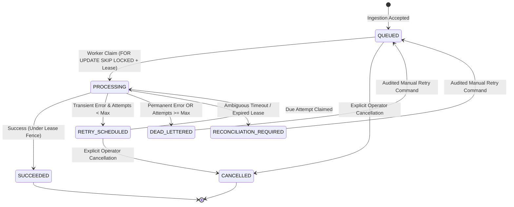
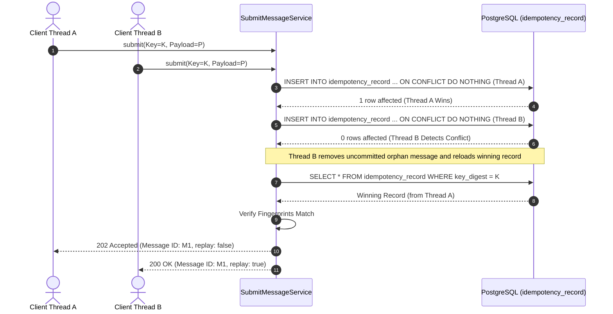
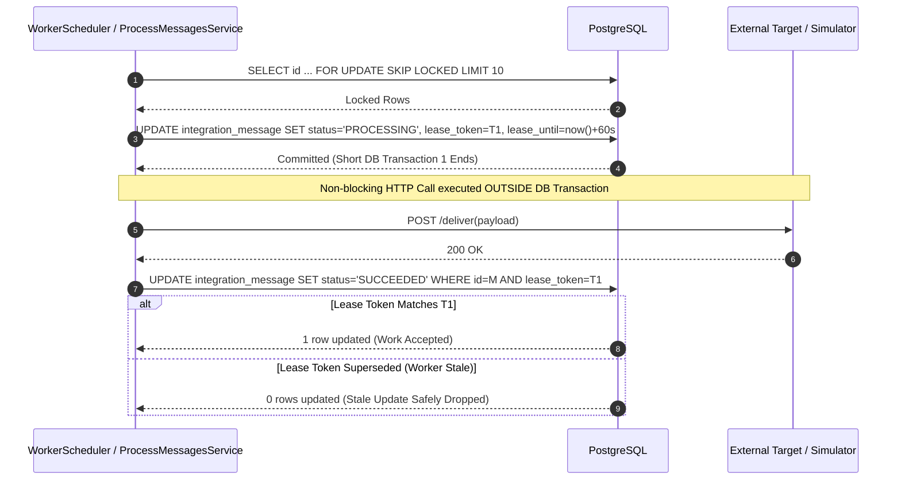

# FlowGuard Enterprise Architecture Specification

## 1. Hexagonal Architecture (Ports & Adapters)

FlowGuard enforces an inward-facing dependency model adhering to Hexagonal Architecture and Domain-Driven Design (DDD).

```mermaid
graph TD
    subgraph Inbound Adapters ["Inbound Adapters (Driving)"]
        REST["REST API (MessageController)"]
        OPS["Operations API (OperationsController)"]
        SCHED["Worker Scheduler (WorkerScheduler)"]
        RECOV["Lease Recovery Scheduler (LeaseRecoveryScheduler)"]
    end

    subgraph Application Core ["Application Core / Ports"]
        SUB_UC["SubmitMessageUseCase"]
        GET_UC["GetMessageUseCase"]
        SEARCH_UC["SearchMessagesUseCase"]
        ATT_UC["GetAttemptsUseCase"]
        RETRY_UC["ManualRetryUseCase"]
        REC_UC["RecoverExpiredLeasesUseCase"]
        PROC_UC["ProcessMessagesUseCase"]
        OPS_UC["GetOperationsSummaryUseCase"]
        
        MSG_PORT["MessageRepositoryPort"]
        IDEMP_PORT["IdempotencyRepositoryPort"]
        ATT_PORT["AttemptRepositoryPort"]
        DELIV_PORT["DeliveryPort"]
        AUDIT_PORT["AuditRepositoryPort"]
    end

    subgraph Pure Domain ["Pure Domain Model (Zero Framework Imports)"]
        AGG["IntegrationMessage Aggregate Root"]
        ATT["ProcessingAttempt Entity"]
        AUD["AuditEvent Record"]
        POLICY["Lifecycle, Retry & Idempotency Policies"]
        VO["Value Objects (MessageId, ClientId, DestinationKey, etc.)"]
    end

    subgraph Outbound Adapters ["Outbound Adapters (Driven)"]
        PG_MSG["PostgresMessageRepositoryAdapter"]
        PG_IDEMP["PostgresIdempotencyRepositoryAdapter"]
        PG_ATT["PostgresAttemptRepositoryAdapter"]
        PG_AUDIT["PostgresAuditRepositoryAdapter"]
        SIM_DELIV["SimulationDeliveryAdapter (@Profile('!prod'))"]
    end

    REST --> SUB_UC
    REST --> GET_UC
    REST --> SEARCH_UC
    REST --> ATT_UC
    REST --> RETRY_UC
    OPS --> OPS_UC
    SCHED --> PROC_UC
    RECOV --> REC_UC

    SUB_UC -.-> MSG_PORT
    SUB_UC -.-> IDEMP_PORT
    PROC_UC -.-> MSG_PORT
    PROC_UC -.-> DELIV_PORT
    PROC_UC -.-> ATT_PORT
    RETRY_UC -.-> MSG_PORT
    RETRY_UC -.-> AUDIT_PORT
    REC_UC -.-> MSG_PORT
    REC_UC -.-> ATT_PORT

    MSG_PORT --> AGG
    IDEMP_PORT --> AGG
    ATT_PORT --> ATT
    AUDIT_PORT --> AUD

    PG_MSG -.->|implements| MSG_PORT
    PG_IDEMP -.->|implements| IDEMP_PORT
    PG_ATT -.->|implements| ATT_PORT
    PG_AUDIT -.->|implements| AUDIT_PORT
    SIM_DELIV -.->|implements| DELIV_PORT
```

---

## 2. Message Lifecycle State Machine

---

## 3. High-Concurrency Idempotency Race Resolution

---

## 4. Worker Claim & Lease Fencing

